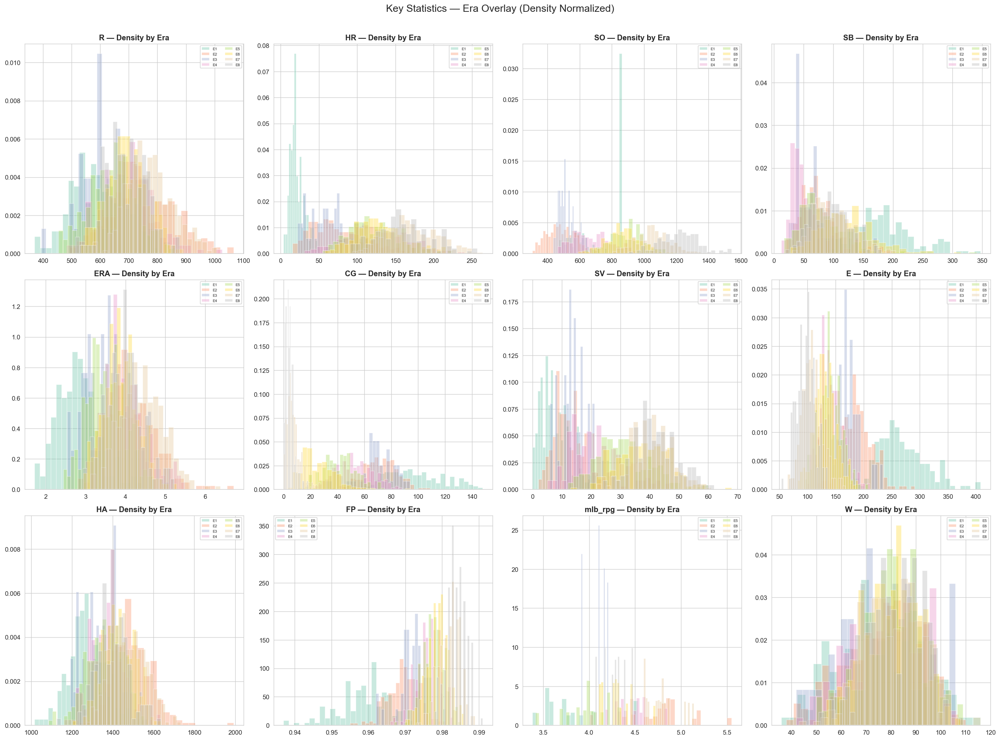

# Moneyball: Predicting MLB Team Wins

Regression models that predict a Major League Baseball team's season wins (`W`) from its batting, pitching and fielding statistics. Built for the Module 3 Kaggle competition (*SCTPDSAI-M3-DS2F Coaching — MoneyBall Analytics*) in the NTU SCTP Advanced Professional Certificate in Data Science & AI, March 2026.

**Metric:** mean absolute error (MAE) in wins, lower is better.
**Best public leaderboard score:** 2.975 MAE. The leader was at 2.959 mid-competition and 2.909 later on.



*Raw counting stats shift enormously across eras (strikeouts, home runs, complete games), which is why most of the work below is about normalisation.*

## Data

| | Rows | `yearID` range |
|---|---|---|
| Training | 1,812 team-seasons | 1904–2016 |
| Test | 453 team-seasons | 1892–2016 |

Each row has 24 team statistics (games played through fielding percentage), `mlb_rpg` (league runs per game that season), one-hot era and decade indicators, and IDs for year, team and franchise. Wins average 79.3 (SD 13.1, range 36–116).

The data files are **not included** in this repository. They were distributed through the course's Kaggle competition and are derived from the [Lahman Baseball Database](https://sabr.org/lahman-database/) (CC BY-SA 3.0). To re-run the work, put these files in the repository root:

- `data_year_team_franchise.csv`, `predict_year_team_franchise.csv`, `sample_submission.csv` (all notebooks and most scripts)
- `data.csv`, `predict.csv` (only `scripts/v13b_stacked_v9round.py`)

## Results

10-fold cross-validated MAE on the training set against the public leaderboard:

| Version | Where | Idea | CV MAE | Public MAE |
|---|---|---|---:|---:|
| V1 | `01_Ridge_Model.ipynb` | RidgeCV on 121 engineered sabermetric features (alpha 7.56) | 2.720 | 2.992 |
| V4 | `02_TwoStage_Model.ipynb` | Pythagenpat expected wins, then Ridge on the residual | 2.716 | 3.021 |
| V5 | `04_PerGame_Normalisation.ipynb` | Counting stats divided by games played, plus raw totals (per-game only: 2.720) | 2.717 | – |
| V6 | `05_Era_Normalisation.ipynb` | Adds within-era z-scores | 2.709 | ≈2.99 |
| V7 | `06_PCA_KMeans_Huber.ipynb` | Huber regression; PCA and K-Means features tested | 2.696\* | 3.029 |
| V8 | `07_Comprehensive_Model.ipynb` | Ridge, Lasso, ElasticNet and Huber compared with full diagnostics | 2.707 | – |
| – | `08_Normalization_Study.ipynb` | Predict win rate (W/G) from lean normalised feature sets | 2.733 | – |
| **V9** | `scripts/v9_optimize.py` | **Equal blend of six Ridge variants predicting W/G** | 2.745 | **2.975** |
| V11–V13 | `scripts/v11…v13b` | Year z-scores, a separate dead-ball-era model, stacking, franchise history | see scripts | – |
| V14 | `scripts/v14_tree_models.py` | XGBoost and LightGBM, alone and blended with Ridge | see script | not recorded |

\* Optimistic. V7 chose Huber's epsilon and alpha by scoring each validation fold, so the validation data leaked into model selection. Notebook 07 evaluates Huber without that leak at 2.711.

Version 8's full comparison (10-fold CV, scaler fitted inside each fold):

| Model | MAE | RMSE | R² |
|---|---:|---:|---:|
| ElasticNet (l1_ratio 0.1) | 2.707 | 3.405 | 0.933 |
| Ridge | 2.709 | 3.405 | 0.933 |
| Huber (epsilon 2.0) | 2.711 | 3.407 | 0.933 |
| Lasso | 2.714 | 3.415 | 0.932 |

`python scripts/v9_optimize.py` regenerates the 2.975 submission as `submissions/v9_blend_all6_fixed.csv` (checked byte-for-byte against the submitted file).

## What I learned

**Cross-validation and the public leaderboard often disagreed.** The two-stage model beat plain Ridge on CV (2.716 vs 2.720) but lost on the leaderboard (3.021 vs 2.992). The six-variant blend did the reverse: worse CV (2.745) and the best public score (2.975).

**The differences were too small for the leaderboard to rank.** With RMSE 3.41 and MAE 2.71, absolute errors have a standard deviation of about 2.1 wins. If the public leaderboard scores about half of the 453 test rows (the split isn't published), one score carries a standard error of roughly 0.14. Comparing two submissions on the same rows is tighter than that, but I didn't measure it. Either way, CV gaps of 0.01–0.03 and public gaps of 0.02–0.05 are weak evidence, and choosing between models by repeatedly checking the leaderboard overfits to it.

**Hyperparameter search needs its own validation.** V7's Huber score looked like the best CV result only because the search picked settings using the same folds it reported on. A nested search (tune inside the training folds, score on the held-out fold) fixes this.

**What I'd do differently:** design the validation split to match the test split (for example folds grouped by season), tune inside the folds, choose models on CV, and keep leaderboard submissions to a handful.

**Feature lessons:**
- Ridge handles the heavy multicollinearity well (errors and fielding percentage correlate at r = −0.996). A 37-feature Lasso subset scored worse publicly (3.06) than the full Ridge model.
- Per-game normalisation removes the 154- vs 162-game season-length effect. Era z-scores remove era-level scoring environments.
- PCA needed 19 components to reach 95% of variance. K-Means team "archetypes" were weak (best silhouette 0.14 at k = 2) and added nothing to the regression.

## Known limitations

- **Era z-scores use train and test together.** Notebooks 05–08 and scripts v9–v14 compute era means and standard deviations (and, in v11–v12, year-level ones) on the combined training and test data, for example `scripts/v13_stack_franchise.py`, line 58. That uses the test set's feature distribution, though not its labels. It's common in Kaggle, but in production the statistics should come from training data only.
- **Shuffled K-fold mixes seasons.** Teams from the same season land in both training and validation folds. Wins within a season are linked across teams, so grouping folds by season would give a more honest estimate.
- **V7's Huber CV score is optimistic** (see the note under Results).
- **Model selection used the public leaderboard.** The `submissions/` folder held 107 candidate files across versions.
- **Some year IDs look wrong.** Four test rows have `yearID` 1892–1899 while their era and decade flags say 1910s–1920s. Features built on `yearID` (year z-scores, franchise history) are affected for those rows.
- Predictions are rounded to whole wins and clipped to 36–120.

## Repository layout

```
01_Ridge_Model.ipynb ... 08_Normalization_Study.ipynb   analysis notebooks, with outputs
analysis.py                       dead-ball era analysis (run from the repository root)
plots_*.png                       EDA figures
scripts/
  eda.py                          data profiling
  model.py, model_v2.py ... v5    early pipelines (V1–V5); write submission CSVs to the root
  ridge_submit.py                 Ridge-only backup submission (writes to the root)
  gen_*_nb.py                     generate notebooks 01–07 (nbformat)
  v9_optimize.py                  six-variant Ridge blend on win rate (the 2.975 submission)
  v11_year_zscore.py              year-level z-score variants
  v12_era1_model.py               separate model for the dead-ball era
  v13_stack_franchise.py          stacked meta-learner, franchise history
  v13b_stacked_v9round.py         stacker with integer-averaging rounding
  v14_tree_models.py              XGBoost / LightGBM and Ridge blends
submissions/                      later scripts write submission files here (not tracked)
```

Notebooks 01–07 are generated by `scripts/gen_*_nb.py`. Notebook 06 also has a hand-added markdown cell (the derived feature dictionary) that its generator doesn't include, so regenerating it would drop that cell. Notebook 08 was written directly.

## Running it

```bash
pip install -r requirements.txt
# put the data files listed above in the repository root, then:
jupyter notebook 01_Ridge_Model.ipynb
python scripts/v9_optimize.py
```

Scripts in `scripts/` locate the data relative to their own location, so they can be run from any working directory.
